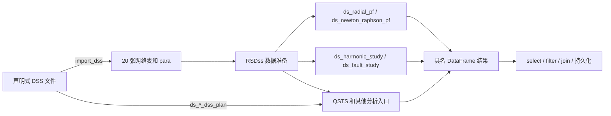

# 从 OpenDSS Python 脚本迁移到 RSS

本文面向已经使用 OpenDSS 或 OpenDSSDirect.py 的配电网仿真用户，说明如何保留现有
`.dss` 模型文件，并把“载入模型、执行分析、读取结果和后处理”迁移到 `mems` 的
RSS（RSDss）脚本。

当前最成熟的迁移路径是静态辐射状配电网潮流、Newton 潮流、谐波和短路计算。仓库中的对照
测试已经用同一批 IEEE 13、34 和 123 节点模型分别运行 OpenDSS 与 RSDss，并比较
复电压；IEEE 13 和 34 节点还比较了谐波复电压与短路复相量，4Bus-DY-Bal 案例比较了
三时点 Daily QSTS 复电压。QSTS、状态估计、随机潮流、恢复重构、故障定位、电动机
动态和保护配合也有 RSDss 入口。显式 DataFrame 工作流仍适合逐表控制；PSA
ExecutionStudy 支持范围内的单个或多个 `Solve` 也可以由执行型入口直接导入和运行。

## 1. 迁移后的执行模型

OpenDSS 同时用一条命令流描述模型和执行过程。RSDss 把两者拆开：



对应关系如下。

| OpenDSS/OpenDSSDirect 操作 | RSDss 操作 |
| --- | --- |
| `Compile` 或 `Redirect` 主文件 | `import_dss("path/to/Master.dss")` |
| `Solution.Solve()` | `ds_radial_pf(...)` 或 `ds_newton_raphson_pf(...)` |
| 一个或多个时序 `Solve` | `ds_radial_dss_plan(...)` 或 `ds_newton_raphson_dss_plan(...)` |
| 原生 `Solve mode=harmonic/harmonict` 命令流 | `ds_dss_harmonic_plan(path, para_or_results)` |
| 已显式准备网络与频谱表的谐波研究 | `ds_harmonic_study(...)` |
| 原生 `Solve mode=autoadd` | `ds_dss_auto_add(path, para_or_results)` |
| 原生 Snapshot 后 `RelCalc` | `ds_dss_relcalc(path, para_or_results)` |
| 创建 `Fault` 后求解或 `mode=faultstudy` | 构造 `fault` 表后调用 `ds_fault_study(...)` |
| `Circuit.AllBusNames`、`Bus.Voltages` | 请求 `bus_phase` 结果 |
| `CktElement.Currents/Powers/Losses` | 请求 `branch_flow`、`source_flow` 等结果 |
| Python 中的筛选、拼接和派生列 | RSDss 的 `select`、`filter`、`join`、`with_columns` |

`import_dss` 是转换器，不是 OpenDSS 命令解释器。它使用
`DssImportProfile::StaticPowerFlow`，把声明式模型转换为 PSA 的 DataFrame 网络契约；
求解由后续 `ds_*` 函数完成。执行型 `import_dss_execution` 和 `ds_*_dss_plan` 则使用
PSA 的有界 ExecutionStudy 契约保留 `Solve`、控制、保护和计量状态。这个边界让脚本中的数据依赖和结果都能进入 mems 流程图，
也防止无法等价表示的 OpenDSS 命令被静默忽略。

Harmonic/HarmonicT、AutoAdd 和 RelCalc 使用各自的 PSA 原生 adapter，不先降为通用 QSTS。
这些函数的第二参数可传 `para` DataFrame，也可直接传逗号分隔结果字符串；字符串形式使用
默认求解参数，适合 `dss2rss` 生成的自包含 linked RSS。完整结果 schema 和限制见
[RSDss 函数参考](dsa_function_reference.md#dss-原生-harmonicautoadd-和-relcalc)。

## 2. 构建要求

RSDss 的配电系统分析函数由 `with_dsa` feature 提供：

```bash
cargo check -p mems --features with_dsa
```

辐射状配电网潮流、谐波和短路入口可以使用这个组合。Newton 潮流、Newton QSTS 和状态估计
需要稀疏线性代数后端，选择项目环境中可用的一种：

```bash
# MUMPS
cargo check -p mems --features with_dsa_mumps

# Intel MKL
cargo check -p mems --features with_dsa_mkl
```

`static` 和 `dynamic` 构建不能同时启用，MUMPS 与 MKL 也不能同时启用。

## 3. 整理 DSS 输入

### 3.1 把模型声明和执行命令分开

提供给 `import_dss` 的入口文件应描述网络对象及其最终属性。它可以通过本地
`Redirect`/`Compile` 引用其他 DSS 文件，也可以使用已经受支持的 `New`、`Edit`、
`More`（`~`）和 `like=` 形成最终模型。

静态入口会拒绝没有静态 DataFrame 语义的执行命令，例如：

- `Solve`；
- `CalcVoltageBases`/`CalcV`；
- 除 `Set DefaultBaseFrequency=...` 外的运行时 `Set`；
- `Export`、`Show` 等依赖 OpenDSS 运行状态的命令。

仓库已验证模型允许在入口开头使用 `Clear` 重置 DSS 声明环境；它不会转换成运行期
DataFrame 动作。需要保留多个 `Solve` 及其间的有序变更时，不能用静态 `import_dss`
表达，应改用 `ds_radial_dss_plan` 或 `ds_newton_raphson_dss_plan`。无法无损进入 PSA typed
continuation contract 的动作仍会 fail closed。

推荐把旧文件拆成两层：

```text
case/
├── model.dss       # Circuit、LineCode、Line、Load、Transformer 等声明
├── lines.dss       # model.dss 可以 Redirect 这个文件
├── loads.dss
├── run_opendss.dss # 保留给 OpenDSS：Compile model.dss、Set、Solve、Export
└── run.rss         # RustScript：import_dss、ds_*、结果处理
```

这样同一份 `model.dss` 可以同时作为 OpenDSS 基准输入和 RSDss 输入。不要为了让导入
成功而删除一个不认识的对象或属性；导入器采用 fail-closed 策略，错误通常表示该语义
还不能无损转换，应先确认兼容范围或把相应设备改为显式 DataFrame 输入。

相对路径以运行 mems 的进程工作目录和 DSS 文件所在目录为基础解析。对于包含多个
`Redirect` 文件的模型，优先使用本地 `import_dss`。`import_dss_url` 适合单个、自包含
的 `.dss` 文件；它不会自动把一个远程目录打包为可解析的文件树。

### 3.2 对齐两边的模型语义

数值对照必须比较同一个电气模型。常见差异包括：

- OpenDSS Vsource 的短路容量会形成内部阻抗，而 PSA 的理想电压源路径可能没有同一
  组阻抗参数；
- OpenDSS 负荷在 `Vminpu/Vmaxpu` 之外可能切换为阻抗模型；
- 调压器、电容器和其他控制器会改变最终档位或状态；
- OpenDSS 的 switch line 可能带默认的小阻抗；
- 变压器初始 tap、负荷模型、相序和端子方向可能不同；
- 近似线路模型与完整相矩阵模型会产生不同结果。

仓库基准为了比较相同模型，会按案例固定 tap、负荷电压范围、控制模式、开关阻抗和
电源阻抗。迁移业务模型时也应先列出这些假设。若目标是逐项复现 OpenDSS，应保留
真实参数并逐项核对；若目标是比较两个求解器，应先把双方输入归一化。

## 4. `import_dss` 的固定返回值

`import_dss` 返回 21 个有序结果：20 张完整网络表，最后是一张参数表。多返回值必须
使用方括号按位置绑定。

```text
[
    bus,
    line,
    linecode,
    load,
    transformer,
    voltage_source,
    motor,
    transformer_winding,
    transformer_impedance,
    current_source,
    generator,
    ibr,
    switch,
    shunt,
    capacitor,
    reactor,
    spectrum,
    control_profile,
    xy_curve,
    storage,
    para
] = import_dss("case/model.dss");
```

位置不能交换。没有相应对象的可选表仍然会返回，但行数为零。`para` 当前至少包含
从 DSS 模型得到的 `base_frequency_hz`，后续用 `with_columns` 在这张单行表上增加
求解参数，可以避免丢失模型基频。

当前 DSS DataFrame 转换结果本身没有 Storage 表，因此上述 `storage` 是固定的零行表。
需要储能时，可在解构中用 `_` 丢弃该位置，并把外部准备的 Storage DataFrame 作为
第 20 个完整网络参数传给求解入口。不要把零行 `storage` 理解为 DSS Storage 已被导入。

## 5. 静态潮流：可直接复制的脚本

下面的脚本使用完整网络形式，保留导入器已经支持的电机、多绕组变压器、Isource、
Generator、IBR、显式开关、并联设备和控制曲线。

```text
[
    bus, line, linecode, load, transformer, voltage_source,
    motor, transformer_winding, transformer_impedance, current_source,
    generator, ibr, switch, shunt, capacitor, reactor, spectrum,
    control_profile, xy_curve, storage, para
] = import_dss("case/model.dss");

pf_para = with_columns(
    alias(exact, line_model),
    alias(bus_phase, result),
    para
);

[voltage] = ds_radial_pf(
    bus, line, linecode, load, transformer, voltage_source,
    motor, transformer_winding, transformer_impedance, current_source,
    generator, ibr, switch, shunt, capacitor, reactor, spectrum,
    control_profile, xy_curve, storage,
    pf_para
);
```

`line_model=exact` 使用完整相矩阵线路模型，是与不平衡 OpenDSS 馈线做对照时的推荐
设置。`result=bus_phase` 请求每个母线相一行的复电压。若不指定 `result`，兼容默认值
是每个母线一行、相量放在 List 列中的 `bus_voltage`。

一次取得多类结果时，`result` 的逗号顺序必须与左值顺序一致：

```text
pf_para = with_columns(
    alias(exact, line_model),
    alias("bus_phase,branch_flow,source_flow,summary", result),
    para
);

[voltage, branch, source, summary] = ds_radial_pf(
    bus, line, linecode, load, transformer, voltage_source,
    motor, transformer_winding, transformer_impedance, current_source,
    generator, ibr, switch, shunt, capacitor, reactor, spectrum,
    control_profile, xy_curve, storage,
    pf_para
);
```

可请求的潮流结果为：

| 结果名 | 用途 |
| --- | --- |
| `bus_voltage` | 兼容格式；每个母线一行，`v_mag/v_ang` 为 List |
| `bus_phase` | 逐母线逐相复电压，适合与 OpenDSS 对照和后处理 |
| `load_state` | 负荷请求值、实际供电 P/Q、最低标幺电压及失电状态 |
| `branch_flow` | 线路和两绕组变压器两端逐相 V/I/P/Q 与损耗 |
| `source_flow` | Vsource/Isource 各端口逐相 V/I/P/Q |
| `transformer_winding_flow` | 每个物理绕组和线圈的 V/I/tap |
| `conductor_flow` | 中性线、同心中性线和带屏蔽导体结果 |
| `regulator_state`、`capacitor_state`、`reactor_state` | 控制设备最终状态 |
| `ibr_state`、`gfm_state` | 并网逆变器和构网逆变器状态 |
| `violations` | 电压、电流和容量越限 |
| `summary` | 收敛、控制动作、求解次数、损耗和越限汇总 |

Newton 版本只需替换函数名，并启用 MUMPS 或 MKL：

```text
newton_para = with_columns(
    alias(exact, line_model),
    alias("bus_phase,branch_flow,summary", result),
    para
);

[voltage, branch, summary] = ds_newton_raphson_pf(
    bus, line, linecode, load, transformer, voltage_source,
    motor, transformer_winding, transformer_impedance, current_source,
    generator, ibr, switch, shunt, capacitor, reactor, spectrum,
    control_profile, xy_curve, storage,
    newton_para
);
```

## 6. OpenDSS 结果与 RSDss 结果的对应

### 6.1 母线电压

OpenDSSDirect 常见写法：

```python
import opendssdirect as dss

dss.Text.Command("Clear")
dss.Text.Command('Compile "case/model.dss"')
dss.Text.Command("CalcVoltageBases")
dss.Solution.Solve()

for bus_name in dss.Circuit.AllBusNames():
    dss.Circuit.SetActiveBus(bus_name)
    nodes = dss.Bus.Nodes()
    values = dss.Bus.Voltages()  # [re1, im1, re2, im2, ...]
```

RSDss 的 `bus_phase` 对应字段为：

| RSDss 列 | 含义 | 单位 | OpenDSSDirect 来源 |
| --- | --- | --- | --- |
| `bus` | 母线名 | — | `Circuit.AllBusNames()` |
| `phase` | 相/端子标签 | — | `Bus.Nodes()` |
| `v_re`, `v_im` | 相对地复电压实部、虚部 | V | `Bus.Voltages()` |
| `v_mag` | 电压幅值 | V | `hypot(v_re, v_im)` |
| `v_ang` | 电压相角 | rad | `atan2(v_im, v_re)` |

OpenDSS 的 `Bus.VMagAngle()` 和部分导出文件使用角度制；`bus_phase.v_ang` 使用弧度。
比较前必须统一单位。谐波结果是一个例外：`ds_harmonic_study` 的
`voltage_angle` 使用度。

### 6.2 支路方向和功率

`branch_flow` 的正方向为 `bus_from → bus_to`：

- `i_from` 从首端母线流入元件；
- `i_to` 从元件流入末端母线；
- `S_from = V_from × conj(I_from)`；
- `S_to = V_to × conj(I_to)`；
- `S_loss = S_from - S_to`。

OpenDSS `CktElement.Currents()` 返回的各端口电流通常都以“从端口流入元件”为正，
所以比较末端电流时需要根据上述约定处理符号。OpenDSS `CktElement.Powers()` 常用
kW/kvar，RSDss 详细结果统一使用 W/var；电流为 A，电压为 V。

### 6.3 名称和相序

连接结果时使用稳定键，不要依赖两边的行顺序：

- 母线电压：`lower(bus), phase`；
- 支路结果：`lower(element), terminal 或端点, phase`；
- 谐波电压：`harmonic, lower(bus), phase`。

OpenDSS 名称匹配通常不区分大小写，而 DataFrame 字符串连接默认区分大小写。对照程序
应先做大小写归一化。还应从 DSS 端子定义取得真实节点号，不要假设每个母线都有
`1,2,3` 三相。

## 7. 谐波计算

谐波输入必须在 DSS 模型中声明受支持的 `Spectrum` 并让相关设备引用它。`h_max` 是
必填正整数：

```text
[
    bus, line, linecode, load, transformer, voltage_source,
    motor, transformer_winding, transformer_impedance, current_source,
    generator, ibr, switch, shunt, capacitor, reactor, spectrum,
    control_profile, xy_curve, storage, para
] = import_dss("case/harmonic_model.dss");

harmonic_para = with_columns(
    alias(7, h_max),
    alias(exact, line_model),
    alias(bus_voltage, result),
    para
);

[harmonic_voltage] = ds_harmonic_study(
    bus, line, linecode, load, transformer, voltage_source,
    motor, transformer_winding, transformer_impedance, current_source,
    generator, ibr, switch, shunt, capacitor, reactor, spectrum,
    control_profile, xy_curve, storage,
    storage,
    harmonic_para
);
```

完整网络的 20 个参数之后还要追加 `monitor` 和 `para`。示例没有 Monitor，因而复用
导入得到的零行 `storage` 作为通用空 DataFrame 占位；第二次出现的 `storage` 实际占据
`monitor` 参数位，并不表示传入第二张 Storage 表。有 Monitor 时应在该位置传入真实的
Monitor DataFrame。可选结果包括
`bus_voltage`、`branch_flow`、`conductor_flow`、`bus_sequence`、
`branch_sequence`、`monitor` 和 `monitor_save`。

`bus_voltage` 的主要列为 `bus,phase,harmonic,voltage_mag,voltage_angle,thd`，单位分别
为 V、度和百分比。OpenDSS 对照测试把幅值和角度重新组成复数后比较，避免相角跨越
±180° 时出现假的大误差。

## 8. 短路计算

短路入口不执行 OpenDSS 命令式 `New Fault ...; Solve`。应先构造 `fault` DataFrame，
再把它交给 `ds_fault_study`。下面从线路端子映射中选择母线 652 的第一组端子，创建
0.1 Ω 的单相接地故障：

```text
selected_terminal = filter(
    cols(bus_to, terminal_map_to),
    cast(col(bus_to), i64) == 652,
    line
);

fault = select(
    alias("652", bus),
    alias(head(col(terminal_map_to), 1), terminal_map),
    alias(slg, kind),
    alias(0.1, zf),
    selected_terminal
);

fault_para = with_columns(alias(exact, line_model), para);

[fault_result] = ds_fault_study(
    bus, line, linecode, load, transformer, voltage_source,
    motor, transformer_winding, transformer_impedance, current_source,
    generator, ibr, switch, shunt, capacitor, reactor, spectrum,
    control_profile, xy_curve, storage,
    fault,
    fault_para
);
```

故障类型支持入口实际接受的 `slg`、`ll`、`llg`、`2pg`、`3p` 和 `3pg`。默认结果
`fault` 包含故障前开路电压、故障后电压和故障电流的幅值/相角列表；需要支路故障
电流时，把 `fault_para.result` 设为 `"fault,branch_flow"` 并声明两个左值。

## 9. QSTS 和其他分析如何迁移

OpenDSS 的 `mode=daily/yearly/duty`、LoadShape、Monitor、EnergyMeter 和保护控制不应
放进静态 `import_dss` 后期待自动执行。RSDss 的 QSTS 入口在完整 20 张网络表后明确
接收：

```text
solution, load_shape, shape_assignment, storage_controller,
switch_control, tcc_curve, fuse, recloser, relay,
monitor, energy_meter, fault, para
```

然后调用：

```text
[voltage, summary, monitor_result, reliability] = ds_radial_qsts(
    bus, line, linecode, load, transformer, voltage_source,
    motor, transformer_winding, transformer_impedance, current_source,
    generator, ibr, switch, shunt, capacitor, reactor, spectrum,
    control_profile, xy_curve, storage,
    solution, load_shape, shape_assignment, storage_controller,
    switch_control, tcc_curve, fuse, recloser, relay,
    monitor, energy_meter, fault, qsts_para
);
```

这些表的 schema 和支持边界见 [README 的准静态时序仿真章节](../../../mems/README.md#准静态时序仿真)。
迁移顺序建议是先用一个静态时点验证网络和单位，再加入曲线与时间轴，最后逐个加入
控制、保护和计量对象。这样每一步都能定位差异来源。

如果原 DSS 已经使用 PSA 支持的 ExecutionStudy 子集，可以保留命令流并直接执行：

```text
# plan_para.result = "bus_phase,summary,execution_trace,diagnostics,events"
[voltage, summary, trace, diagnostics, events] = ds_radial_dss_plan(
    "case/run.dss",
    plan_para
);
```

单个 `Solve` 也可以用 `import_dss_execution` 展开成 QSTS 的 33 张输入表，另带
`diagnostics` 和 `events`。多 `Solve` 计划的逐 epoch 结果增加 `epoch_index` 与
`solve_event_sequence`；执行轨迹覆盖整个命令流，并可记录 fault-aware 保护过程。

仓库中的 [`4bus_daily_qsts.rss`](../4bus_daily_qsts.rss) 是可直接运行的
最小 Daily QSTS 示例。它在脚本中构造三个一小时时步、0.5/1.0/1.5 的负荷倍数及其
LoadShape 绑定，并请求逐母线逐相电压；测试将 36 行复电压与 OpenDSS 参考结果按
`time + bus + phase` 对齐，复数相对误差容差为 `1e-3`。曲线在时步起点采样，结果以
时步结束时刻标记。

其他 OpenDSS 工作流与 RSDss 入口的选择如下：

| 工作目标 | RSDss 入口 |
| --- | --- |
| 径向/弱网静态潮流 | `ds_radial_pf` |
| 通用 Newton 静态潮流 | `ds_newton_raphson_pf` |
| Daily/Yearly/Duty 时序 | `ds_radial_qsts` / `ds_newton_raphson_qsts` |
| 保留原 DSS Daily/Yearly/Duty/PeakDay/LD1/LD2 命令流 | `ds_radial_dss_plan` / `ds_newton_raphson_dss_plan` |
| 谐波扫描 | `ds_harmonic_study` |
| 保留原 DSS Harmonic/HarmonicT 命令流 | `ds_dss_harmonic_plan` |
| 原生 AutoAdd / RelCalc | `ds_dss_auto_add` / `ds_dss_relcalc` |
| 短路 | `ds_fault_study` |
| WLS/鲁棒状态估计 | `ds_wls_se` / `ds_mnmr_se` / `ds_mce_se` |
| Monte Carlo | `ds_monte_carlo` |
| 故障恢复重构 | `ds_restore` |
| 故障定位 | `ds_fault_location` |
| 电机网络动态 | `ds_motor_dynamics` |
| 保护配合审计 | `ds_protection_coordination` |

## 10. 在 mems 中运行 RSS 脚本

已有完整 OpenDSS 执行主文件时，可以先用严格转换器生成 RSS：

```bash
cargo run -p mems --features tensoreval-cli,with_dsa --bin dss2rss -- \
  path/to/run.dss --output path/to/run.rss
```

也可以直接计算 DSS 入口：

```bash
cargo run -p mems --features tensoreval-cli,with_dsa --bin tensoreval -- \
  path/to/run.dss
```

若只需生成同目录同名的 RSS 而不执行生成脚本，可使用：

```bash
cargo run -p mems --features tensoreval-cli,with_dsa --bin tensoreval -- \
  --dss-to-rss path/to/run.dss
```

该参数也可写成 `--dss2rss`、`--dsstorss` 或 `--dss_to_rss`。

转换器会解析完整命令流，分类为 Snapshot、ExecutionPlan、Harmonic、AutoAdd 或 RelCalc，
再通过对应 PSA 入口完成导入和一次实际计算。生成的 specialist RSS 还会通过 expr_df
重新执行后才返回；可能改变 OpenDSS 结果的导入 Warning 会使转换失败，并逐项输出诊断码
与源位置。ExecutionPlan 中已经被 typed study 消费的 `READ.DSS.RETAINED_SOURCE_ONLY`
仍作为提示返回，不会被误判为丢失执行语义。

`tensoreval` 命令行工具可以直接运行 RSS（RSDss）文件。脚本使用 `import_dss` 等自包含入口时
不需要外部 DataFrame：

```bash
cargo run -p mems --bin tensoreval \
  --features tensoreval-cli,with_dsa -- \
  --dataframe sparrowzz/dss/ieee13_power_flow.rss
```

脚本可以通过 `import_dss("path/to/network.dss")` 导入网络、执行潮流并生成具名结果。
DSS 路径相对于命令运行时的工作目录解析。仓库中已由 OpenDSS 参考结果验证的潮流、
谐波、短路和 QSTS 脚本见 [`sparrowzz/dss`](../README.md)。

普通 DataFrame 脚本可重复使用 `--input NAME=FILE` 注入 CSV、XLS/XLSX 或 Parquet：

```bash
cargo run -p mems --features tensoreval-cli --bin tensoreval -- \
  --dataframe \
  --input input=path/to/input.csv \
  path/to/script.rss
```

命令会按脚本声明顺序打印所有末层结果的变量名和 DataFrame；`--verbose` 还会打印
schema。RSDss 错误会写入标准错误并返回非零退出码。使用
`cargo run -p mems --features tensoreval-cli --bin tensoreval -- --help` 查看完整参数。

在持久化流程中，把脚本放入 `TensorEval` 节点并设置 `TE_PARA_DF`。节点输入的别名会
成为脚本中的 DataFrame 变量，末层变量成为节点输出。`import_dss` 自己可以作为零输入
节点读取本地模型。

对外执行入口是 `tensoreval --dataframe`（或 `--df`）。Rust 内部模块接口不作为
RSDss 对外兼容契约；应用集成应通过脚本文件、命令行退出码和具名结果 DataFrame
建立稳定边界。

## 11. 建立 OpenDSS 对照基准

迁移时应保留一套独立的 OpenDSS oracle。推荐流程如下：

1. 固定 OpenDSSDirect.py、DSS C-API、模型文件和所有外部曲线文件的版本。
2. 用 Python 只调用 OpenDSS，不导入 PSA，也不读取 RSDss 输出。
3. 记录复数原始量，例如 `v_re/v_im`、`i_re/i_im`，并保存为 CSV。
4. RSDss 使用同一声明式模型，显式记录为对齐语义所做的投影。
5. 用规范化后的业务键连接两边结果，检查行覆盖完整性。
6. 比较复相量相对误差，而不是分别比较幅值和角度。

仓库当前锁定基准使用 OpenDSSDirect.py 0.9.4 和 DSS C-API 0.14.5。业务项目可以采用
自己的版本，但必须把版本和基准文件一起固定；升级 OpenDSS 后应重新生成参考结果并
审查数值变化。

仓库潮流对照使用：

```text
absolute_error = hypot(actual_re - expected_re, actual_im - expected_im)
relative_error = absolute_error / max(hypot(expected_re, expected_im), 1.0)
```

IEEE 13、34、123 节点静态潮流当前使用 `1e-3` 最大相对误差门限。这个门限是现有
固定案例的验收值，不应直接当作所有业务网络的通用容差。业务验收还应检查：

- 两边是否覆盖完全相同的母线、相、支路和端口；
- 求解是否收敛，控制动作是否符合预期；
- 总有功/无功损耗；
- 最大电压偏差和最大支路电流偏差；
- 控制器最终 tap、级数、开关和保护状态；
- 时序计算中每个时点的时间戳和倍率。

## 12. 仓库中的可复现证据

关键文件：

- `mems/tests/dff/dff_script.rs`：DSS 导入、RSDss 脚本执行及 OpenDSS 结果比较；
- `psa/tests/bmopf/generate_opendss_voltage.py`：独立 OpenDSSDirect 潮流基准生成器；
- `psa/tests/bmopf/generate_opendss_ieee13_harmonics.py`、
  `generate_opendss_ieee34_harmonics.py`：独立谐波基准生成器；
- `psa/tests/bmopf/generate_opendss_short_circuit.py`：独立短路基准生成器；
- `psa/tests/bmopf/*_opendss_*.csv`：锁定的 OpenDSS 参考结果；
- `psa/tests/bmopf/opendss_inputs/`：IEEE/CIGRE 原始 DSS 输入。

运行迁移路径的聚焦回归测试：

```bash
cargo test -p mems --test main --features with_dsa \
  dff::dff_script::dsa_tests -- --test-threads=1
```

也可以只运行一个案例：

```bash
cargo test -p mems --test main --features with_dsa \
  imports_ieee13_dss_and_matches_opendss \
  -- --test-threads=1
```

CIGRE-LV 谐波案例在 debug 构建中很慢，完整验证应使用 release：

```bash
cargo test --release -p psa --test network_harmonics --features mumps-static \
  cigre_lv_network_voltage_and_branch_currents_match_opendss \
  -- --exact --test-threads=1
```

日常文档和 IEEE 迁移测试不需要运行这个慢用例。

## 13. 常见失败及处理

| 症状 | 原因 | 处理 |
| --- | --- | --- |
| `unsupported DataFrame function: import_dss` | 构建未启用 `with_dsa` | 启用 `with_dsa` 或对应后端 feature |
| `DSS command ... is outside the StaticPowerFlow...` | 模型文件混入 `Solve`、`Clear`、运行时命令 | 拆分模型文件和执行脚本 |
| `Set ... has no StaticPowerFlow DataFrame semantic` | 静态导入只接受基频设置 | 把求解设置写入 `para` 或相应分析配置表 |
| `expected a .dss file` | 路径/URL 后缀不正确 | 使用实际 `.dss` 入口文件 |
| `cannot open` / include 错误 | 工作目录、相对路径或远程附件不完整 | 使用本地完整文件树并核对 `Redirect` 路径 |
| `ResultCountMismatch` | `para.result` 数量与左值数量不同 | 按相同顺序逐个声明左值，可用 `_` 丢弃 |
| `para.result ... unknown/duplicates` | 结果名错误或重复 | 使用对应 `ds_*` 入口支持的结果名 |
| 辐射状配电网潮流失败 | 网络并非辐射状、拓扑无效或设备超出入口能力 | 检查诊断，必要时改用 Newton |
| Newton 函数不可用或链接失败 | 没有选择 MUMPS/MKL | 启用一个 `with_dsa_*` 后端 |
| 电压整体有固定偏差 | 电源阻抗、tap、负荷电压模型或线路模型不同 | 先对齐模型语义，再比较求解器 |
| 相角差约 57.3 倍 | rad/deg 混用 | 静态详细结果用 rad，谐波结果用 deg |
| 末端支路电流符号相反 | OpenDSS 与 `branch_flow.i_to` 方向不同 | 按端口方向约定转换符号 |
| DSS 中有 Storage，导入后表为空 | 当前 `import_dss` 不输出 Storage 表 | 从外部 DataFrame 提供 Storage |

## 14. 推荐迁移顺序

1. 固定一个小型代表性馈线和 OpenDSS 版本。
2. 从原脚本中分离声明式 `model.dss`。
3. 只请求 `bus_phase`，完成一个静态时点的复电压对照。
4. 增加 `branch_flow`、`source_flow` 和 `summary`，核对方向、单位和损耗。
5. 逐项恢复 Generator、IBR、开关、调压、电容和其他对象，并保留每一步基准。
6. 再迁移谐波、短路或 QSTS；每种分析建立独立 oracle 和容差。
7. 把验证后的脚本放入带 `TE_PARA_DF` 的 mems 流程，并配置输入、输出和持久化。
8. 在 CI 中运行聚焦对照测试；慢速 CIGRE-LV 谐波测试放到 release 测试任务。

完成这些步骤后，OpenDSS 仍可作为独立基准生成器，而日常仿真、DataFrame 后处理和
流程编排由 RSDss 承担。新增对象或属性时，应先扩展兼容性测试和独立参考结果，再把
它加入生产模型。
